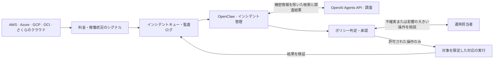

# SRE Agent

[English](README.md) · [日本語](README.ja.md)

OpenClaw向けのマルチクラウド障害対応基盤です。AWS、Azure、Google Cloud、Oracle Cloud Infrastructure（OCI）、さくらのクラウドで、料金の急増やサービス障害を検知できる構成を目指しています。

**現在の状態：** ローカルで模擬データのデモを実行できます。実環境との連携や自動復旧はまだ有効になっていません。

## アーキテクチャ



## 仕組み

- クラウドごとのアダプターが、請求・リソースの状態・サービスの監視情報を共通形式に揃えます。古い情報や欠損は「不明」とし、正常や料金ゼロとはみなしません。
- Slackに依存せず、OpenClawがインシデントの管理と担当者への相談を行います。OpenAI Agents APIは証拠を調べて対応案を出しますが、承認や実行はしません。
- 対応を実行できるのは、別のポリシー判定で明示的に許可された操作だけです。影響が大きい操作や不確実な操作は担当者に確認し、返答がなければ承認とはみなしません。実行後は結果を検証します。

## 模擬デモを実行する

SQLiteを利用できるPython 3.10以降が必要です。追加の依存パッケージや認証情報は不要です。リポジトリのルートから実行してください。

```sh
cd examples/synthetic_signals
demo_dir="$(mktemp -d)"
python3 -B sre_mvp.py --db "$demo_dir/signals.sqlite3" demo
python3 -B sre_mvp.py --db "$demo_dir/signals.sqlite3" demo
python3 -B sre_mvp.py --db "$demo_dir/signals.sqlite3" list
python3 -B sre_mvp.py --db "$demo_dir/signals.sqlite3" incidents
python3 -B sre_mvp.py --db "$demo_dir/signals.sqlite3" cost --policy cost_policy.json --as-of 2026-01-15T13:05:00Z
python3 -B -m unittest -v
```

初回は模擬シグナル25件を保存し、再送5件を除外します。2回目は30件すべてが再送として扱われ、新規保存はありません。各クラウドには料金・障害・復旧・遅延・欠損のサンプルがあります。遅延した観測値は保持し、欠損はゼロや正常ではなく「不明」とします。再送で元の記録は上書きされません。

読み取り専用の `incidents` コマンドは、`incidents` と `unapplied_health_evidence` を持つバージョン付きJSONオブジェクトを返します。デモではクラウドごとに1件、計5件の解決済みインシデントが出ます。インシデントのキーには開始時の障害イベントの送信元・スコープ・イベントIDを使い、根拠にはそれらのキーと各イベントの観測・受信時刻（UTC）を含めます。

障害をまとめるのは、クラウド・送信元・スコープ・環境・サービス・対象がすべて同じ場合だけです。イベントは受信順ではなく観測時刻順に並べ、より後の時刻に観測された遅延のない復旧イベントがあり、同時刻に障害がなければ解決と判定します。その後の再発は別のインシデントになります。観測の欠損、遅れて届いた復旧、判定が曖昧な復旧、対応する未解決の障害がない復旧は、理由付きで別に出力します。これは履歴から作るスナップショットなので、より早い障害イベントが後から追加されるとIDが変わることがあります。インシデント一覧が空でも、現時点で正常とは限りません。

DBが存在しない場合や保存済みの根拠が無効な場合は、空の結果を返さずエラーになります。元の料金シグナルは `list` で確認できます。どのコマンドもOpenClawやOpenAI Agents APIを呼び出さず、復旧操作も実行しません。

### 料金判定ポリシー

読み取り専用の `cost` コマンドには、ポリシーファイルと固定のUTC時刻 `--as-of` が必要です。バージョン1のポリシーは、クラウド・送信元・スコープ・環境・サービス・対象・料金種別・期待する通貨（`unit`）・金額の上限（`threshold`）・観測時刻からの経過秒数の上限（`max_age_seconds`）を指定し、ルールごとに判定と根拠を返します。条件を満たす観測値が上限を超えれば `anomaly`、上限以下ならそのルールに限り `within_limit` です。実績・予測・推定は別々に評価し、予測の異常を確定請求とはみなしません。デモは個々の観測値を比較するだけで、v1には請求期間の項目や集計・通貨換算はありません。

判定には指定時刻までに受信した根拠だけを使い、同じルールに該当する種別の最新受信を評価します。古い値への差し戻しはしません。受信済みのシグナルがない場合や、欠損・到着遅延・鮮度超過・矛盾・観測と到着の順序逆転・不一致がある場合は、理由付きの `unknown` とし、料金ゼロや上限内とはみなしません。観測から受信までが1時間を超えると到着遅延、判定時刻でルールの許容経過時間を超えると鮮度超過です。別の料金種別で代用することもありません。判定対象外の行や指定時刻より後に受信した行も含め、DB内の全行を検証します。DBの不在、不正なポリシーや保存データは、空の結果ではなくエラーになります。

上限との比較や同じ観測時刻の金額の矛盾判定には、ポリシーのJSONとSQLiteに実際に保存されたJSONの数値を、十進数としてそのまま使います。結果の金額は二進浮動小数点数に丸めずJSON数値で出力します。精度を保つには、読み手側も十進数として読み取ってください。保存前に失われた精度は復元できません。既存DBの移行は不要です。

SQLiteは `mode=ro` で開くため、データやスキーマへの書き込みは行いません。ただしWALモードでは、SQLiteが補助ファイル（`-wal` と `-shm`）を必要としたり、作成したりする場合があります。

同梱の模擬ポリシーでは、AWSは観測欠損で不明、AzureはJPYの予測が異常、GCPは推定の到着遅延で不明、OCIはルールが要求する予測を受信していないため不明、さくらのクラウドはJPYの予測が上限内になります。デモの再送後も、同じ判定時刻で実行すれば同一のJSONが返ります。

## 開発計画

1. 模擬インシデントと認証不要のローカルテストから始める。
2. クラウドごとに、読み取り専用の監視データ取得と調査を追加する。
3. 本番への書き込みなしで、対応の提案から承認までを検証する。
4. 対象を絞った復旧操作を非本番環境で試し、検証を経て対象を広げる。

クラウドとAPIの認証は運用担当者が別途設定します。認証情報、アカウント識別子、本番環境の調査データをコミットしないでください。

クラウドごとの監視情報、データ形式、段階導入の条件は[5クラウドの全体設計](docs/architecture.md)を参照してください。調査の設計は[OpenAI CookbookのSRE Agent例](https://developers.openai.com/cookbook/examples/agents_api/apps/sev_bot/readme)をもとにしています。
