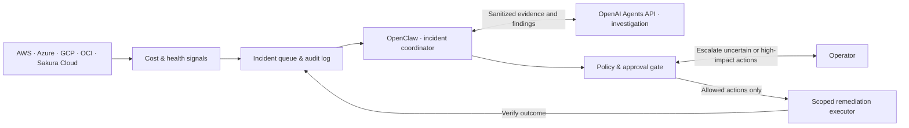

# SRE Agent

[English](README.md) · [日本語](README.ja.md)

A multi-cloud incident operations harness for OpenClaw. It is designed to detect cost spikes and service failures across AWS, Azure, Google Cloud, Oracle Cloud Infrastructure, and Sakura Cloud.

**Status:** A local synthetic signal demo is available. Live integrations and remediation are not enabled.

## Architecture



## How it works

- Cloud adapters normalize billing, resource health, and service signals. Stale or missing data is reported as unknown, not healthy or free.
- OpenClaw manages incidents and escalations without a Slack dependency. The OpenAI Agents API investigates evidence and proposes next steps; it does not approve or execute changes.
- A separate policy gate allows only explicitly scoped remediation. Higher-impact or uncertain actions go to the operator; a missing reply is not approval. Each applied action must be verified.

## Run the synthetic demo

Requires Python 3.10+ with SQLite support. No dependencies or credentials are needed. From the repository root, run:

```sh
cd examples/synthetic_signals
demo_dir="$(mktemp -d)"
python3 -B sre_mvp.py --db "$demo_dir/signals.sqlite3" demo
python3 -B sre_mvp.py --db "$demo_dir/signals.sqlite3" demo
python3 -B sre_mvp.py --db "$demo_dir/signals.sqlite3" list
python3 -B sre_mvp.py --db "$demo_dir/signals.sqlite3" incidents
python3 -B -m unittest -v
```

The first run stores 25 synthetic signals and skips five replays. The second stores nothing new and skips all 30 inputs. Each provider contributes cost, outage, recovery, late, and missing observations. Late observations retain their value; missing observations are unknown, not zero or healthy. Replays never overwrite the original event.

The read-only `incidents` command produces one versioned JSON object with `incidents` and `unapplied_health_evidence`. The demo yields five resolved incidents, one per provider. An incident is keyed by its opening outage's stored source, scope, and event ID. Its evidence includes those stored keys and the observed and received UTC times for each event.

Outages group only within the same provider, source, scope, environment, service, and target. Events are replayed by observation time, not receipt order. Only a strictly later fresh recovery with no simultaneous outage can resolve an incident; a later recurrence starts a new one. Missing observations, late recoveries, ambiguous recoveries, and recoveries with no open incident are reported separately with reasons. This is a historical snapshot: backfilling an earlier opening outage can change an incident ID. An empty incident list does not establish current health.

The command fails rather than treating a missing database or invalid stored evidence as an empty incident list. Raw cost signals are still available via `list`; no cost anomaly is classified without a policy. No commands call OpenClaw, the OpenAI Agents API, or run remediation.

## Development plan

1. Start locally with synthetic incidents and credential-free tests.
2. Add read-only cloud telemetry and investigation, one provider at a time.
3. Exercise the proposal and approval loop without production writes.
4. Pilot narrowly scoped remediation in non-production before expanding coverage.

Cloud and API authentication are configured separately by the operator. Do not commit credentials, account identifiers, or production evidence.

See the [five-cloud architecture (Japanese)](docs/architecture.md) for the provider signals, data contracts, and rollout gates. The investigation design is based on the [OpenAI SRE agent Cookbook](https://developers.openai.com/cookbook/examples/agents_api/apps/sev_bot/readme).
