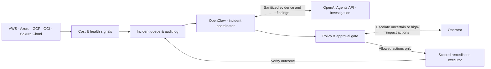

# SRE Agent

A multi-cloud incident operations harness for OpenClaw. It is designed to detect cost spikes and service failures across AWS, Azure, Google Cloud, Oracle Cloud Infrastructure, and Sakura Cloud.

**Status:** The architecture is documented. Live integrations and remediation are not enabled.

## Architecture

## How it works

- Cloud adapters normalize billing, resource health, and service signals. Stale or missing data is reported as unknown, not healthy or free.
- OpenClaw manages incidents and escalations without a Slack dependency. The OpenAI Agents API investigates evidence and proposes next steps; it does not approve or execute changes.
- A separate policy gate allows only explicitly scoped remediation. Higher-impact or uncertain actions go to the operator; a missing reply is not approval. Each applied action must be verified.

## Development plan

1. Start locally with synthetic incidents and credential-free tests.
2. Add read-only cloud telemetry and investigation, one provider at a time.
3. Exercise the proposal and approval loop without production writes.
4. Pilot narrowly scoped remediation in non-production before expanding coverage.

Cloud and API authentication are configured separately by the operator. Do not commit credentials, account identifiers, or production evidence.

See the [five-cloud architecture](docs/architecture.md) for the provider signals, data contracts, and rollout gates. The investigation design is based on the [OpenAI SRE agent Cookbook](https://developers.openai.com/cookbook/examples/agents_api/apps/sev_bot/readme).
