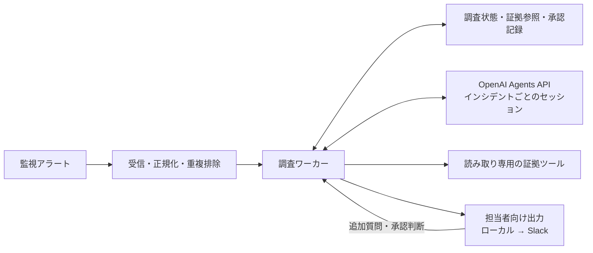

# SRE Agent — 概要設計

OpenAI Agents API を使い、オンコール担当者が障害の影響と直近の変更を短時間で確認できるようにする。エージェントは根拠付きで調査結果と緩和案を提示する。**本番変更は実行しない。ロールバック案の承認は判断の記録であり、実行ではない。**

ステータス：設計のみ。対象サービス・監視基盤・本番接続先は未決定。

## 1. 最初に作るもの

1. 架空サービス `checkout-api` のアラートをローカルで受け付ける。同じ障害への重複通知をまとめ、調査 ID を返す。
2. 同梱の合成データ（エラー率、ログ抜粋、デプロイ履歴、PR、過去事例）を読み取り専用ツールから取得し、インシデントごとに作成した Agents API セッションで調査する。
3. 影響、UTC の時系列、観測事実、原因仮説、反証・未取得データ、次に行う確認、緩和案を返す。主な記述にはツール応答が発行した証拠 ID を付け、アプリ側で参照の存在を確認する。証拠不足なら「不明」とし、直近のデプロイが原因だと決めつけない。
4. 二度目の質問では同じセッションを使う。ロールバック案が出た場合は承認・却下・期限切れを記録する。完了または期限切れ後は、調査記録を保存しセッションと実行環境を片付ける。

初回実装は **合成データとローカルの確認画面またはCLI**。オフライン試験ではAPIクライアントを差し替え、実APIの疎通は別の試験にする。Slack、実監視、GitHub、クラウドの認証情報は初回実装では不要。合成の結果には常に「サンプルデータ」と明示する。

## 2. 処理構成

| 部品 | 責務と境界 |
| --- | --- |
| 受信・ワーカー | プロバイダーの認証後にイベントを正規化し、永続化できたものだけを受け付ける。同じインシデントの処理は直列化。タイムアウト・失敗は調査結果と区別する。 |
| Agents API アダプター | 公式例に沿って `client.beta.agents.sessions` でセッションを作成し、`sessions.stream` でターンを開始する。SDKのバージョンは実装時に固定し、イベント型と復帰方法を検証する。 |
| 証拠ツール | 初期は `get_service_evidence` と `recall_incidents`。アプリが許可するサービス・環境・時間範囲に絞り、エラーと「該当なし」を区別する。ツールごとに件数・サイズ・時間を制限する。 |
| 実行環境 | 公式例の self-hosted sandbox を使う場合は、インシデントごとに分離し、runbook を読み取り専用で配置。アプリのAPIキー、Slack・GitHub・クラウドの資格情報は渡さない。接続が必要な場合は用途を限定した executor キーを別に扱う。 |
| 永続ストア | 単一ノードのMVPでは SQLite。障害ID、イベントID、セッションID、状態、証拠参照、判断者・時刻、後片付け状態を保存。複数ワーカーへの拡張は別途設計する。 |

## 3. ライフサイクルと承認

- 受信の重複排除は **送信元＋イベントID**、進行中の調査のひも付けは **送信元＋サービス＋環境＋fingerprint**。解決済みの次の発生は別のインシデントとして扱う。同時に来た作成要求はDBで競合を解決する。
- 状態は `queued → investigating → awaiting_decision`（提案がある場合）`→ reported → resolved`。失敗・期限切れは調査状態と理由を分けて記録する。セッション作成や通知の結果が不明なときは、確認なしに再作成・再送しない。
- `propose_rollback` は自動ハンドラーに登録しない。公式例の OpenAI `agent.session.action_required` を署名検証し、セッションの `required_actions` を取得する。提案IDと `turn_id`・`call_id`、対象、根拠、有効期限を保存する。
- 担当者の権限、対象インシデント、提案の有効性をアプリが検証し、判断を一度だけ確定する。公式例の `sessions.events.create` に `agent.session.input.tool_result` として返し、常に `executed: false` とする。モデルは承認者にならない。Slack連携時はイベントとボタンも署名検証し、同じ担当者向けスレッドで扱う。
- 解決後の履歴には、担当者が確認した事実と対応を残す。推測は確定原因に昇格させない。セッション削除と環境の後片付けは個別に状態を残し、一方の失敗でも他方を試みる。

## 4. 本番データをつなぐ前の境界

- ログ、PR本文、runbook、過去事例は**証拠データ**として扱い、内容の指示でツール権限・送信先・承認条件を変えない。自由なURL・シェル・書き込み系の運用ツールは公開しない。
- APIに渡す前に、秘密・個人情報・機密ログを除去または要約する。APIへ送れるデータの種類、保存期間、担当者の閲覧権限を実データ接続前に決める。合成データで実障害の証拠を補完しない。
- 本番コネクターは、まず1サービスで監視・デプロイ履歴とGitHubの読取を接続。公式例にはGitHub/AWS MCPがあるが、採用はデータの送信先と権限を確認してから。デプロイ、ロールバック、スケーリング、設定更新の権限は持たせない。
- 調査ごとに時間・ツール呼び出し・同時実行数の上限を設ける。受付、重複、初報までの時間、証拠取得失敗、保留、後片付け待ちを観測し、秘密やログ本文を監査ログに入れない。

## 5. 実装順と合格条件

| 段階 | 確認すること |
| --- | --- |
| 0. 合成の縦切り | 同一アラートの重複で調査が増えない。合成障害に対して根拠付きの報告を出す。ログやメトリクスを欠落させると、不明と明示する。 |
| 1. Agents API実接続 | 合成データだけで1回調査し、同じセッションで追加質問できる。承認・却下・期限切れ・重複への挙動を確認し、いずれも本番操作が0件。再起動後も調査と承認の記録を照合できる。 |
| 2. テスト用Slack | 署名付きイベントを受け、1障害＝1スレッド。権限外の判断を拒否し、解決時の記録保存と後片付けを確認する。 |
| 3. 1サービスで読取試験 | 承認済みの限定データで、時系列・根拠・初報までの時間を人手調査と比較。担当者のレビューを経て対象拡大を判断する。 |

## 参考

- [OpenAI Cookbook: Build an SRE agent for incident response](https://developers.openai.com/cookbook/examples/agents_api/apps/sev_bot/readme)
- [公式サンプルのソース](https://github.com/openai/openai-cookbook/tree/main/examples/agents_api/apps/sev_bot)

公式例はSlackトラフィックを実際に送信し、同梱データは本番の診断ではない。例のファイル保存は解決済み履歴向けで、進行中のセッション・承認は再起動に耐えない。本設計では、ローカルから始めることと進行状態を永続化することを変更点とする。
