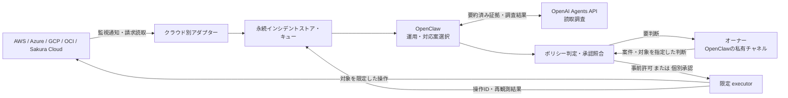

# SRE Agent / AI Operations Harness — 全体設計

**状態：設計案。** 対象は AWS、Azure、Google Cloud、Oracle Cloud Infrastructure（OCI）、さくらのクラウドの5つ。公開リポジトリには設計・合成サンプルのみを置く。通知先、対象アカウント、認証情報、監視対象や実際の障害データはリポジトリ外で管理する。

## 1. 実現したい運用

5クラウドで料金急増とサービス障害を検知し、OpenClaw（運用エージェント）に集約する。OpenAI Agents API は調査と対応案の作成に使う。OpenClaw はインシデント管理、許可された対応の選択、追跡、判断に困る案件のオーナーへの照会を担う。**Slack は不要**。人の判断が必要な場合だけ、OpenClaw が普段使う認証済みのDMや運用画面を案内する。返事がないことは承認にしない。

各クラウドにはそのクラウドの通知・読取を担う接続口を設置し、必要な場合のみ限定 executor を追加する。5つの常駐LLMや全環境に効く共通管理者権限は不要。管理プレーンが止まっても、各クラウドの既存アラートは独立して残す。

## 2. クラウド別の検知

以下は公式仕様に基づく初期接続候補。記載の更新間隔は通知の到達保証ではない。契約、権限、リージョン、配信の実測は導入時に確認する。受信できない信号は定期取得で補い、取得できない信号を正常扱いしない。

| クラウド | コストの入口 | 障害・メンテナンスの入口 |
| --- | --- | --- |
| AWS | [Cost Anomaly Detection](https://docs.aws.amazon.com/cost-management/latest/userguide/manage-ad.html) と [Budgets](https://docs.aws.amazon.com/cost-management/latest/userguide/budgets-managing-costs.html) の実績・予測を利用。Budgets は通常8〜12時間間隔、最大1日3回更新。分析は Cost Explorer／[CUR 2.0 Data Exports](https://docs.aws.amazon.com/cur/latest/userguide/what-is-data-exports.html) | [AWS Health → EventBridge](https://docs.aws.amazon.com/health/latest/ug/cloudwatch-events-health.html) で公開イベントとアカウント固有イベントを区別。公開イベントを Oregon の単一ルールに頼らない。[直接 Health API](https://docs.aws.amazon.com/health/latest/ug/health-api.html) は対象 Support プランが必要。ワークロード側は CloudWatch Alarms |
| Azure | [Budgets](https://learn.microsoft.com/en-us/azure/cost-management-billing/costs/tutorial-acm-create-budgets) の実績・予測をメール／Action Groupへ。通常8〜24時間のデータ遅延、評価は24時間ごと。[Cost Management Exports](https://learn.microsoft.com/en-us/azure/cost-management-billing/costs/tutorial-improved-exports) で明細を補完。通常の予算超過でリソースは停止しない | [Azure Status／Service Health／Resource Health](https://learn.microsoft.com/en-us/azure/service-health/overview) を広域公開／契約に関連する障害・保守／個別リソースに分ける。Service Health 用の [Action Group](https://learn.microsoft.com/en-us/azure/azure-monitor/alerts/action-groups) は Global、Resource Health は別アラート |
| GCP | [Cloud Billing Budgets → Pub/Sub](https://cloud.google.com/billing/docs/how-to/budgets-programmatic-notifications) と [BigQuery 請求エクスポート](https://cloud.google.com/billing/docs/how-to/export-data-bigquery)。通常の予算は通知のみ。[Spend Cap Budget](https://docs.cloud.google.com/billing/docs/how-to/budgets-spend-caps) は対象サービス・プロジェクトの新規利用に限って停止でき、全体上限ではない | [Personalized Service Health](https://docs.cloud.google.com/service-health/docs/overview) の API／Cloud Logging 通知を主経路にし、[公開ダッシュボード](https://status.cloud.google.com/) は広域重大障害の補助。ワークロード側は Cloud Monitoring |
| OCI | [Budgets](https://docs.oracle.com/en-us/iaas/Content/Billing/Concepts/budgetsoverview.htm) は実績・予測のメール通知。評価頻度の記載に差があるため毎時通知を前提にしない。[Cost and Usage Reports](https://docs.oracle.com/en-us/iaas/Content/Billing/Concepts/costusagereportsoverview.htm) は6時間ごとに生成され、後着データもある | [Announcements → Notifications](https://docs.oracle.com/en-us/iaas/Content/General/Concepts/announcements_topic-Subscribing.htm) と [公開Status](https://ocistatus.oraclecloud.com/) を別信号として扱う。Monitoring Alarms と Health Checks はワークロードの監視であり、事業者の障害通知の代わりではない |
| さくらのクラウド | [料金アラート](https://manual.sakura.ad.jp/cloud/payment/alert.html) は実績・予測をメール／Webhookで通知。実績は前日分までを原則6時間ごとに確認し、予測は毎時評価でも発報は原則月下旬。データ不足なら発報されない。[請求API](https://manual.sakura.ad.jp/cloud/api/billapi.html) でプロジェクト単位・全ゾーン合算の日次明細を補完 | [公開稼働情報](https://status.cloud.sakura.ad.jp/) と対象者への通知に加え、[ホストメンテナンスAPI](https://manual.sakura.ad.jp/cloud/api/hostmaintenanceapi.html) で利用中のサーバ／アプライアンスの予定を取得する。このAPIは突発障害用ではない。全体障害の汎用APIは確認できていないため、[シンプル監視](https://manual.sakura.ad.jp/cloud/appliance/simplemonitor/index.html) などの外形監視を独立させる |

**料金検知：** 実績／予測／推定を分け、通貨、集計窓、データ確定度、最終更新時刻を保持。各アカウントの予算、金額差と増加率、持続時間、サービス別寄与をルールで評価する。更新が遅い請求信号は最終確認に使う。早く検知したいものは起動数・転送量・稼働時間などの利用量を先行信号にする。未着や欠損を請求ゼロと見なさず、推定だけでは課金系の書込を発動しない。

**障害検知：** クラウドの状態通知と、サービス側のSLI（エラー率・遅延・外形監視）を分離。回復通知、関連変更、既知のメンテナンスを相関させる。監視データが取れない場合は `unknown`、クラウド障害が濃厚なときは自環境への無用な再起動を避ける。検知ルールはLLMなしでも作動する。緊急のSLO通知は独立した外形監視から発報し、事業者告知やOpenClawの集計を待たない。

## 3. 共通契約と状態管理

| 契約 | 必須情報と境界 |
| --- | --- |
| `Signal` | バージョン、provider、非公開スコープ参照、サービス・環境、対象参照、種別、event ID、観測・受信時刻、鮮度、値／単位と証拠参照。送信元は認証し、イベント本文のスコープ指定だけを信頼しない。 |
| `Incident` | 受信は送信元＋スコープ＋event IDで重複排除。進行中はスコープ＋サービス＋症状fingerprintで相関し、解決後の再発は別ID。異なるクラウドの通知をまとめても出典は保持する。 |
| `Investigation` | 影響、事実、証拠ID、原因候補、反証、情報鮮度、不明点、次の確認。Agents API のsession／turnとincidentを対応付け、未完了のストリームや未取得データを成功扱いしない。 |
| `Proposal` | 案件、対象、アクションID、型付き引数、根拠、想定影響、事前条件、成功条件、戻し方、期限。自然言語の命令を実行引数にしない。 |
| `Decision / Outcome` | policy版・判定者・判断時刻、対象と操作の固定ハッシュ、実行冪等キー、プロバイダー操作ID、確認結果。監査では「承認」「送信」「適用」「回復確認」を区別。 |

受信と実行は永続キュー、状態と監査はアプリが所有。初期の単一ノードではSQLite、複数ワーカー化ではトランザクション・排他・共有永続DBを設計する。キューは少なくとも1回配信を前提に、受信・判断・操作ごとに冪等化する。状態は `detected → investigating → proposed → awaiting_owner / allowed → applying → verifying → resolved`。対応不要、失敗、不明、延期、期限切れも別状態で残す。対象ごとの同時変更制限と、永続化した操作IDによる再照合を行う。

## 4. OpenClawを運用ハーネスにする

常設のSREサービスがインシデントを保存し、OpenClawは認証付きの専用アダプターから受け取る。初期は認証付きの取得・ACKで接続し、必要に応じて受信通知を足す。[OpenClawの定期ジョブ](https://docs.openclaw.ai/automation/cron-jobs) は集計・再照合に使い、即時通知の必須経路にはしない。[Webhook入力](https://docs.openclaw.ai/gateway/config-hooks) を使う場合は、アダプターで送信元を検証し、さくらのSlack互換JSONなどクラウド固有の形式を正規化して、専用トークンで渡す。具体的な製品プラグイン面・権限設定は実装時に検証する。通常チャットへの生ログ貼り付けや、Slackのスレッドを状態ストアにする構成は採らない。

OpenClawに公開する操作は論理契約として `list_incidents`、`get_incident`、`request_investigation`、`submit_proposal`、`get_outcome` から始める。他の運用AIを接続するときも同じ契約を使い、エージェントごとに呼び出せる操作と対象を分離する。OpenClaw自体に全クラウドの書込鍵は渡さない。人による承認は案件・対象・具体的な操作に結び付いた専用の確認経路で行い、自由形式チャットやモデルの判断を本人承認の代わりにしない。

OpenAI Agents API の調査は [Cookbook](https://developers.openai.com/cookbook/examples/agents_api/apps/sev_bot/readme) の案件単位セッションと証拠ツールを再利用する。機密情報を削除した証拠だけを渡し、証拠を権限変更の指示として扱わない。承認・実行はこのプロジェクトの管理プレーンに残す。Agents APIやOpenClawが停止しても検知イベントは残り、期限切れの権限で対応を続けない。

## 5. 自動レメディエーション

| レベル | 誰がどう判断するか | 例 |
| --- | --- | --- |
| **自動** | オーナーが事前登録した操作に限り、OpenClawが対応を選択。ポリシーが対象・上限・鮮度・影響範囲を確認し、限定 executor が実行 | テスト環境の単一ステートレスワーカーを1回だけ再起動。事前登録した非本番バッチを、予算閾値と別の利用量信号が一致した場合に一時停止 |
| **個別承認** | OpenClawが提案し、オーナーに影響・証拠・他の選択肢・戻し方・期限を提示。承認は1案件・1操作・1対象のみ有効 | 本番ロールバック、予算急増時の本番バッチ一時停止、影響を限定できる本番容量調整 |
| **この版では実行しない** | 機械・人の判断にかかわらず executor が受理しない。別の管理手順で扱う | データ削除、権限変更、ネットワーク境界変更、クラウド契約変更、任意のシェルやAPI呼出し |

ポリシーはモデル出力とは別に適用し、対象・期限・事前条件が変われば承認を無効化する。操作ごとに dry-run または事前照合、並行数・回数・費用／変更量の上限、待機時間、復旧条件を定義する。実行後にクラウドの操作状態と独立したヘルス指標を読み戻し、応答消失時は同じ操作IDを照合する。確定できないときは再送せず担当者へ。失敗時の戻しも事前許可された範囲に限る。クラウド別・操作別・全体の停止スイッチを用意し、管理系停止時は書込を止める。

クラウド側の資格情報は **監視・請求読取** と **限定実行** を別にし、executor に対象と操作を固定した短期権限を使う。短期化できないサービスでは個別保管・ローテーション・失効経路を設ける。証拠の原本は適切な保存先に留め、OpenClawや通知には必要な要約と認可された参照だけを出す。

## 6. 段階導入と受入条件

1. **合成データの縦切り。** 5クラウドの料金・障害・回復・遅配・重複・欠損を正規化し、OpenClawで案件確認、Agents APIで根拠付き調査、模擬 executorで判断経路を通す。本物のクラウド書込は0。
2. **5クラウドの読取を順次追加。** 最初の1クラウドでスコープ・鮮度・障害通知と料金信号の違いを実測し、残りへ展開。通知と実態を人の調査と比較。未接続、利用不可、遅延を可視化する。
3. **提案のみ運用。** OpenClaw が「何もしない／提案／オーナーに照会」を選べること、重複承認・期限切れ・対象違いが拒否されることを確認。本番書込はまだ無効。
4. **限定自動化。** 非本番の1クラウド・1操作から、障害と料金それぞれの選定済み対応を試行。上限、停止、操作結果不明、独立指標での復旧を検証後、安定した操作だけを段階的に展開する。5クラウドで検知できることと、全クラウドで同じ操作を自動化できることは別。

実装前の未決事項：最初のクラウドとサービス、対象スコープ、通知チャネル、コストしきい値・鮮度目標、順次許可する操作リスト。これらは実設定で管理し、公開設計には書かない。旧[概要設計](../README.md)の「書込なし」は初期MVPの条件であり、最終形では本節の検証を通過した操作だけを開放する。
